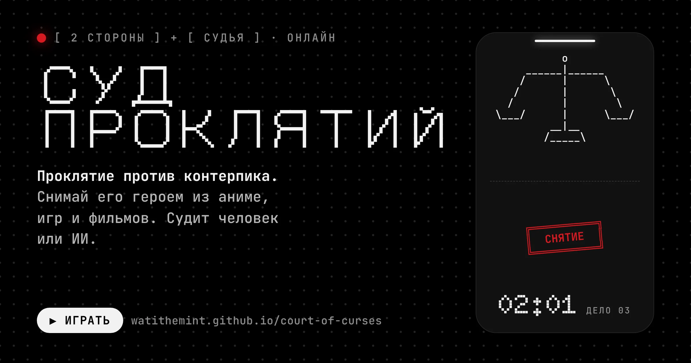
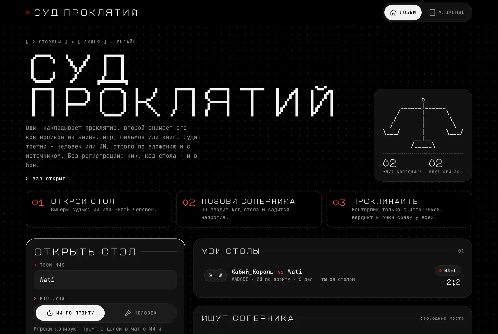
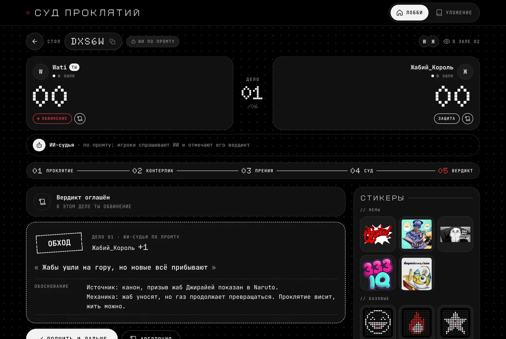
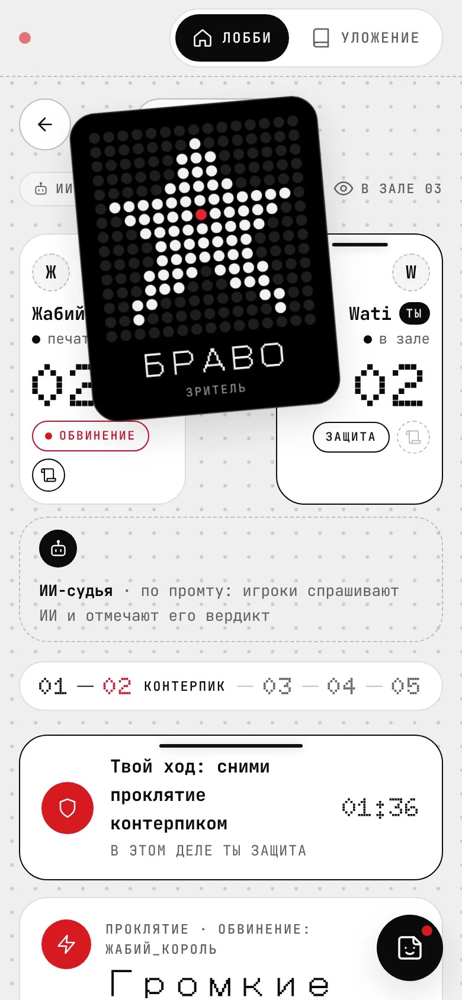
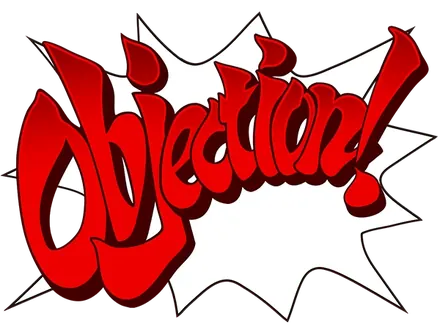
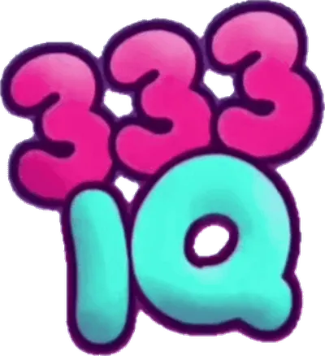

<div align="center">



<br>

**Проклятие против контерпика.**<br>
Один накладывает проклятие, второй снимает его героем, стендом или законом мира из аниме, игр, фильмов и книг.<br>
Судит третий - живой человек или ИИ, строго по Уложению и с источником.

[](https://watithemint.github.io/court-of-curses/)


`[ без регистрации ] · [ ник + код стола ] · [ и в бой ]`

<br>



</div>

<br>

## `> ЧТО ЭТО`

Party-игра на 2-6 человек, выросшая из переписки «назови проклятие - а я найду, кто его снимет».

- **Обвинение** придумывает проклятие: триггер, эффект, масштаб и один подвох.
- **Защита** снимает его кем-то из канона - и обязана сказать, где это показано.
- **Судья** решает по Уложению, работает ли контерпик. Очки, роли меняются, следующее дело.

Никаких универсальных отмычек: Imagine Breaker и кинжальчик Медеи тут - фол.

<br>

## `> КАК ИГРАТЬ`

| | |
|:--|:--|
| **`01`** **Открой стол** | Введи ник, выбери судью (ИИ по промту или человек) и длину матча. |
| **`02`** **Позови соперника** | Нажми «Ссылка на стол» и кинь её другу. Или просто продиктуй код из 5 символов. |
| **`03`** **Проклинайте** | Жребий решит, кто проклинает первым. Вердикт и очки появляются у всех сразу. |

Остальные по ссылке заходят зрителями: смотрят, кидают стикеры, садятся на свободное место.

За очки и доигранные матчи капают печати ✦ - на них в **Лавке** открываются новые коллекции стикеров.

<br>

## `> РЕЖИМЫ`

| Режим | Кто играет | Как идёт |
|:--|:--|:--|
| **Дуэль** | 2 игрока + судья | Роли меняются каждое дело. 4, 6 или 10 дел. |
| **Карусель** | 3-6 игроков, каждый сам за себя | Очередной игрок проклинает соседа по кругу. За круг каждый один раз проклинает и один раз защищается. 1-3 круга. |

**Кто судит**

- **ИИ** - промт с делом копируется в чат с любым ИИ.
- **Человек** - отдельное место судьи.
- **Присяжные** - в дуэли до 4 зрителей, в карусели все, кто не участвует в деле. Голоса тайные, решает большинство.

**Модификаторы** - включаются тумблерами и сочетаются:

| | |
|:--|:--|
| **Связывающий обет** | Перед матчем каждому выпадают 3 случайные вселенные. От одной он отказывается до конца матча, и это видят все. |
| **Выжженная земля** | Вселенная, из которой взяли контерпик, сгорает для всех. |
| **Жребий вселенных** | Каждое дело Защите выпадают 3 случайные вселенные - снимать только из них. |

Стол сам узнаёт вселенную по полю «Произведение» и предупреждает о нарушении, а последнее слово за судьёй.

<br>

## `> ХОД ДЕЛА`

```
 [01] ПРОКЛЯТИЕ ──▶ [02] КОНТЕРПИК ──▶ [03] ПРЕНИЯ ──▶ [04] СУД ──▶ [05] ВЕРДИКТ
   триггер            до 2 вопросов      1 реплика       человек      очки,
   эффект             + кто снимает      Обвинения       или ИИ       протокол,
   масштаб            + источник         + 1 ответ       по промту    смена ролей
   подвох
```

<div align="center">

</div>

<br>

## `> УЛОЖЕНИЕ`

Полный свод - во вкладке «Уложение» на сайте. Главное:

| Закон | Суть |
|:--|:--|
| **Кинжальчика** | Нельзя выдать себе силу. Способность применяет её владелец, по канону и со всеми ограничениями. Универсальные отмычки - фол. |
| **Источника** | Произведение + кто или что + где показано. Канон и официальные материалы, без хэдканонов. Выдумал - фол. |
| **Проклятия** | Триггер + эффект + масштаб. Один подвох закрывает один класс контров, но не все. Правка задним числом - фол. |
| **Сожжённых карт** | Сыгранная способность сгорает для обоих. Повтор - фол Защиты. Стол сам предупредит. |

```
 ╔══════════╗   ┌╌╌╌╌╌╌╌╌╌┐   ┌──────────┐   ┏━━━━━━━━━━━━━━┓   ┏━━━━━━━━━━━━━━━━━┓
 ║  СНЯТИЕ  ║   ╎  ОБХОД  ╎   │  ПРОВАЛ  │   ┃  ФОЛ ЗАЩИТЫ  ┃   ┃  ФОЛ ОБВИНЕНИЯ  ┃
 ╚══════════╝   └╌╌╌╌╌╌╌╌╌┘   └──────────┘   ┗━━━━━━━━━━━━━━┛   ┗━━━━━━━━━━━━━━━━━┛
  Защита +2      Защита +1    Обвинение +1     Обвинение +2         Защита +2
```

Плюс **Изящество** +1 за особенно красивый ход. У каждой стороны **одна апелляция** на матч - и решение по ней окончательное.

<br>

## `> ИИ-СУДЬЯ ПО ПРОМТУ`

Без API-ключей и платных подписок:

1. На стадии суда жмёшь **«Скопировать промт»** - в нём всё дело и всё Уложение.
2. Вставляешь в чат с любым ИИ - например, [Claude](https://claude.ai).
3. Отмечаешь печать, которую он поставил, и вставляешь его разбор. Вердикт видят все.

Хочется живого судьи - выбери «Человек»: третий игрок садится на место судьи и решает сам.

<br>

## `> СТИКЕРЫ`

<table>
<tr>
<td width="44%" valign="top">

</td>
<td valign="top">

Видят все в зале, с ником отправителя.

**Мемы**

     

*Objection! ещё и трясёт стол.*

**Базовые** - точечная матрица 15×15, как дисплей Nothing:

```
ХА-ХА  ·  ОГОНЬ  ·  БРАВО
КАНОН? ·  КРИНЖ  ·  GG
```

На телефоне стикеры живут в круглой кнопке справа внизу.

</td>
</tr>
</table>

<br>

## `> ЛАВКА`

Стикеры собраны в коллекции по 6-9 штук. **Базовые** и **Мемы** есть у всех сразу, остальные покупаются за печати ✦.

| За что | Печати |
|:--|:--|
| старт | **+10** |
| каждое своё очко в деле | **+1** |
| победа в матче | **+5** |
| доигранный матч без победы | **+2** |
| вердикт судьи-человека | **+1** |
| голос присяжного | **+1** |

Платные коллекции:

- **Зал суда** - девять точечных стикеров от «Порядок!» до «Проклято», 40 печатей.
- **Мелл** - шесть анимированных реакций, 30 печатей.

    

Кошелёк привязан к браузеру, как и анонимный вход.

<details>
<summary><b>Как добавить свою коллекцию</b></summary>

<br>

Картинки кладутся в `assets/packs/<id>/`, а сама коллекция описывается в `assets/packs/packs.json`:

```json
[
  {
    "id": "jojo",
    "name": "ДжоДжо",
    "desc": "Позы, стенды и «ора-ора».",
    "price": 30,
    "stickers": [
      { "file": "1.webp", "w": 400, "h": 400, "alt": "Джотаро указывает" },
      { "file": "2.webp", "w": 400, "h": 400, "alt": "Дио смеётся" }
    ]
  }
]
```

- `id` - латиница и цифры, до 8 символов.
- `price: 0` - коллекция бесплатная для всех.
- 6-9 стикеров, лучше WebP около 400 px с прозрачным фоном.

</details>

<br>

## `> ПОД КАПОТОМ`

- **Чистый HTML, CSS и JS** - ES-модули без сборки и фреймворков.
- **Firebase**: анонимный вход и Firestore. Столы, присутствие «в зале» и «печатает…», стикеры - всё в реальном времени.
- **GitHub Pages** раздаёт статику, сервера нет.
- **Шрифты**: [Doto](https://fonts.google.com/specimen/Doto) для цифр, [DotGothic16](https://fonts.google.com/specimen/DotGothic16) для заголовков, [JetBrains Mono](https://fonts.google.com/specimen/JetBrains+Mono) для текста.
- Тёмная и светлая темы по системе, всё работает с телефона.

```
court-of-curses/
├── index.html          разметка и Уложение
├── style.css           Nothing OS + ASCII
├── app.js              логика игры и Firebase
├── firestore.rules     правила доступа к базе
└── assets/
    ├── og.png          превью ссылки для Telegram и Discord
    ├── stickers/       мемы
    ├── packs/          коллекции для лавки и packs.json
    └── readme/         баннер и скриншоты для этого файла
```

<details>
<summary><b>Данные в Firestore</b></summary>

<br>

| Путь | Что лежит |
|:--|:--|
| `matches/{code}` | стол: режим, места, порядок карусели, модификаторы и обеты, фаза дела, голоса присяжных, вердикт, протокол |
| `matches/{code}/presence/{uid}` | кто сейчас в зале и печатает ли (пульс раз в 25 секунд) |
| `matches/{code}/events/{id}` | отправленные стикеры |
| `players/{uid}` | кошелёк: печати, купленные коллекции, за какие дела уже начислено |

Правила в `firestore.rules`: читать может любой вошедший, менять стол - только те, кто за ним сидел. Новичок может только сесть за стол. Закрыть стол может только создатель. Кошелёк видит и меняет только его хозяин.

</details>

<details>
<summary><b>Поднять свою копию</b></summary>

<br>

1. Форкни репозиторий.
2. В [Firebase Console](https://console.firebase.google.com) создай проект и веб-приложение, скопируй `firebaseConfig` в начало `app.js`.
3. **Authentication → Sign-in method → Anonymous → Enable.**
4. **Firestore Database → Create database**, затем **Rules** → вставь `firestore.rules` → **Publish**.
5. **Authentication → Settings → Authorized domains** → добавь `ТВОЙНИК.github.io`.
6. **Settings → Pages → Deploy from a branch → `main` / `(root)`**.

Ключ Firebase в `app.js` публичный по задумке - базу защищают правила, а не секретность ключа.

</details>

<br>

---

<div align="center">

<sub>Мемы-стикеры принадлежат их правообладателям и используются в фан-игре.</sub>

```
> заседание объявляется открытым_
```

</div>
